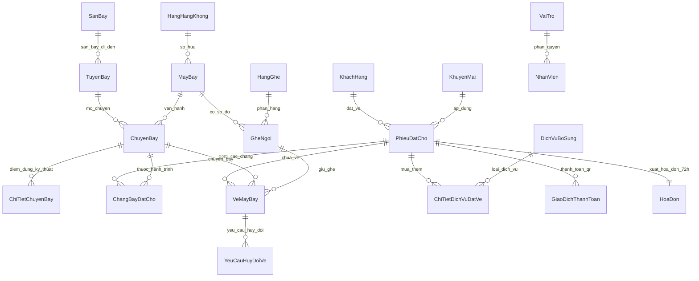

# Hệ Thống Đặt Vé Máy Bay Trực Tuyến SkyVN Air (`QL_DatVeMayBay`)

Đồ án môn **Phân tích Thiết kế Hệ thống Thông tin (PTTK HTTT)** xây dựng trên nền tảng **ASP.NET Core MVC (.NET 8) + SQL Server (ADO.NET / Stored Procedures) + SignalR**.

---

## 1. Hướng dẫn cài đặt & chạy nhanh

### Yêu cầu môi trường
- .NET 8 SDK
- SQL Server 2019 / 2022 (hoặc SQL Express) + công cụ `sqlcmd` hoặc SSMS

### Bước 1: Khởi tạo cơ sở dữ liệu
Chạy toàn bộ script tái tạo CSDL chuẩn hóa kèm dữ liệu mẫu quy mô lớn (> 4.700 chuyến bay, 1.448 ghế, 105 đơn đặt):
```powershell
sqlcmd -S "." -E -b -I -f 65001 -i "QL_DatVeMayBay\Database\QL_DatVeMayBay.sql"
```
> **Lưu ý kết nối:** `QL_DatVeMayBay/appsettings.json` đang cấu hình `Server=.;Database=QL_DatVeMayBay;...` (instance mặc định `MSSQLSERVER`). Nếu máy bạn dùng SQL Server Express, đổi `Server=.` thành `Server=.\SQLEXPRESS`.

### Bước 2: Chạy ứng dụng Web
```powershell
cd QL_DatVeMayBay
dotnet build
dotnet run
```

---

## 2. Tài khoản Demo (Mật khẩu chung: `123456`, đã mã hóa PBKDF2-SHA256)

| Phân hệ | Tài khoản / Email | Vai trò |
|---|---|---|
| **Hành khách** | `duyenan@gmail.com` / `ngocnhu@gmail.com` | Đặt vé, quản lý chuyến bay, mua thêm dịch vụ, check-in, xuất VAT |
| **Ban Giám Đốc** | `admin` | Toàn quyền quản trị lịch bay, voucher, nhân sự, doanh thu |
| **Thu ngân** | `thungan` | Đối soát hóa đơn, thanh toán |
| **Bán vé** | `banve` | Hỗ trợ đặt/giữ chỗ |
| **CSKH** | `cskh` | Hỗ trợ đổi chuyến, hủy vé, khiếu nại |

---

## 3. Sơ đồ quan hệ thực thể (ERD Tổng quát)



---

## 4. Các quy tắc nghiệp vụ cốt lõi đã chuẩn hóa
1. **Tìm kiếm Một chiều & Khứ hồi (`MOT_CHIEU` / `KHU_HOI`)**: Đã loại bỏ hoàn toàn chế độ nhiều chặng; tối đa 9 hành khách/đơn, `Em bé < 2 tuổi <= Người lớn`, đóng bán trước giờ khởi hành **60 phút**.
2. **Lịch giá vé thấp nhất theo tháng**: `GET /Home/GiaTheoThang` gọi `sp_GiaThapNhatTheoNgay`, định dạng rút gọn `k`, tô xanh ngày rẻ nhất.
3. **Nối chuyến & Khứ hồi chung 1 PNR**: `sp_TimChuyenQuaCanh` ghép 2 chặng thật (nối chuyến 60p nội địa / 120p quốc tế, tối đa 8h, tổng ≤ 24h); khứ hồi cùng ngày lượt về phải sau giờ hạ cánh lượt đi ≥ 2h; toàn bộ đặt trong `sp_DatVeMayBay_Batch` trên 1 PNR duy nhất.
4. **Giấy tờ tùy thân bắt buộc & Tính giá**: Người lớn 100% + thuế phí (CCCD 12 số / Hộ chiếu), Trẻ em 2–11t 90% + thuế phí, Em bé < 2t 10% giá cơ bản (ngồi cùng người lớn, `MaGhe NULL`); chặng quốc tế yêu cầu Hộ chiếu còn hạn ≥ 6 tháng.
5. **Chống tranh chấp & Giữ chỗ 15 phút**: `SERIALIZABLE` + `WITH (UPDLOCK, HOLDLOCK)` + Filtered Unique Index `UX_VeMayBay_ActiveSeat`, `SeatHub` SignalR đồng bộ 4 trạng thái ghế thời gian thực, `SeatHoldCleanupService` quét mỗi 10s giải phóng đơn hết hạn 15 phút.
6. **Mua dịch vụ bổ sung sau đặt vé**: Hợp lệ trước giờ bay ≥ 3h (hành lý/suất ăn) và trước Check-in (đổi ghế); bắt buộc tạo giao dịch `DICH_VU` thanh toán qua VietQR rồi mới cập nhật `HoaDon`.
7. **Hóa đơn điện tử VAT 72h**: Chặn tuyệt đối sau 72h kể từ thời điểm thanh toán, hỗ trợ cá nhân & doanh nghiệp (validate Mã số thuế 10/13 số), bản in có đọc tổng tiền bằng chữ tiếng Việt.

---

## 5. Tài liệu phân tích & kiểm thử đính kèm
- Phân tích tham khảo UX thực tế: [`docs/PHAN_TICH_THAM_KHAO.md`](docs/PHAN_TICH_THAM_KHAO.md)
- Kịch bản & script kiểm thử đồng thời: [`docs/TEST_DONG_THOI.md`](docs/TEST_DONG_THOI.md)
- Báo cáo kết quả kiểm thử thực tế (10/10 PASS): [`docs/KET_QUA_KIEM_THU.md`](docs/KET_QUA_KIEM_THU.md)

---

## 6. Ghi chú về Cổng thanh toán VietQR Sandbox & Cách thay cổng thật
- Hệ thống hiện sử dụng **`SandboxPaymentGateway`** (triển khai interface `IPaymentGateway` trong `Services/PaymentGatewayService.cs`) để sinh QR VietQR + chữ ký xác thực HMAC-SHA256 và mô phỏng webhook trả về `POST /Payment/Callback` (idempotent). **Không phát sinh trừ tiền ngân hàng thật.**
- Để tích hợp cổng thanh toán thật (VNPay / MoMo / PayOS / VietQR Casso/SePay): tạo class mới triển khai `IPaymentGateway` (ví dụ `PayOsPaymentGateway`), đăng ký trong `Program.cs` thay cho `SandboxPaymentGateway`, và trỏ webhook của nhà cung cấp về `POST /Payment/Callback` với khóa bí mật cấu hình trong `PaymentGateway:HmacSecret`.
